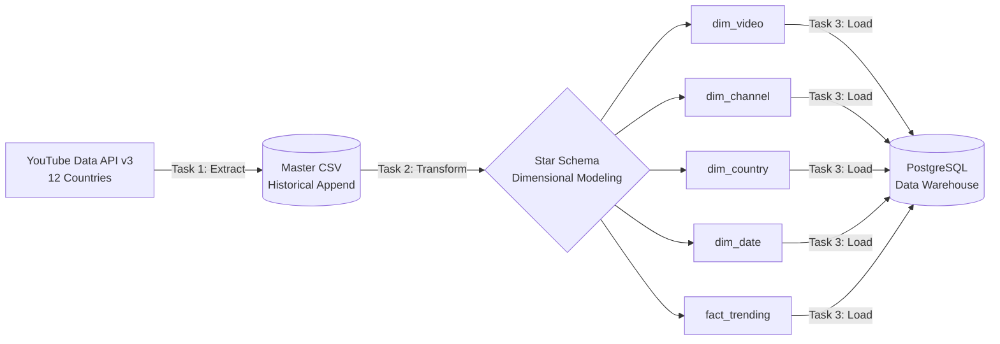

# 📺 YouTube Trending Data Warehouse & Airflow ETL Pipeline

[](https://www.python.org/)
[](https://airflow.apache.org/)
[](https://www.postgresql.org/)
[](https://www.docker.com/)
[](https://pandas.pydata.org/)

An automated, end-to-end **Extract, Transform, Load (ETL)** data engineering pipeline orchestrated with **Apache Airflow** and containerized via **Docker**. This pipeline ingests daily trending video metrics across **12 global regions** using the YouTube Data API v3, models the data into a normalized **Star Schema**, and loads it into a **PostgreSQL** data warehouse for analytical querying.

> *Note: This repository is the production-orchestrated evolution of my foundational [Youtube-Trending-Videos](https://github.com/SHAIKGHOUSE6/Youtube-Trending-Videos) project, upgrading standalone scripts into a scheduled, modular Airflow DAG with dimensional modeling.*

---

## 🏗️ Pipeline Architecture



### Workflow Breakdown
1. **Extract (`extract_youtube_data`):** Queries the YouTube Data API v3 (`mostPopular` chart) across 12 countries (`IN`, `US`, `GB`, `CA`, `AU`, `DE`, `FR`, `BR`, `JP`, `KR`, `MX`, `PK`). Appends daily snapshots to a persistent master dataset while deduplicating by `(Video_ID, Country_Code, Date)`.
2. **Transform (`transform_star_schema`):** Cleans text fields, converts ISO 8601 video durations (e.g., `PT1H10M44S`) into total seconds, extracts UTC publication date attributes, standardizes schema naming conventions, and splits the flat dataset into normalized Dimension and Fact tables.
3. **Load (`load_to_postgres`):** Connects securely via Airflow `PostgresHook` and SQLAlchemy to load all 5 star-schema tables into PostgreSQL.

---

## ⭐ Data Warehouse Star Schema

The data is modeled into **1 Fact Table** and **4 Dimension Tables** to support fast analytical aggregations across regions, channels, and time periods:

| Table Name | Type | Primary Key | Description & Key Columns |
| :--- | :--- | :--- | :--- |
| **`fact_trending`** | **Fact** | `(date, video_id, country_code)` | Daily trending performance metrics: `views`, `likes`, `comments`. |
| **`dim_video`** | **Dimension** | `video_id` | Video metadata: `channel_id`, `title`, `published_date`, `duration_seconds`, `definition`, `caption_available`, `country_code`. |
| **`dim_channel`** | **Dimension** | `channel_id` | Creator details: `channel_id`, `channel` (channel title). |
| **`dim_country`** | **Dimension** | `country_id` | Geographic lookup: surrogate `country_id`, `country_code`, `country`. |
| **`dim_date`** | **Dimension** | `date_id` | Calendar attributes: surrogate `date_id`, `date`, `year`, `week`, `published_date`, `month`, `published_day`, `published_day_name`. |

---

## 📂 Repository Structure

```text
youtube-trending-airflow-warehouse/
├── dags/
│   └── my_first_dag.py             # Main Airflow TaskFlow API DAG (Extract -> Transform -> Load)
├── src/
│   ├── youtube_trending.py         # Standalone extraction script
│   └── first.ipynb                 # Exploratory data analysis & schema prototyping notebook
├── config/                         # Custom Airflow configurations
├── plugins/                        # Airflow plugins directory
├── docker-compose.yaml             # Multi-container Airflow deployment config
├── requirements.txt                # Python dependencies
├── uv.lock                         # Locked dependency versions
├── .python-version                 # Python 3.13 version specification
├── .gitignore                      # Excludes .env, logs/, .venv/, and local CSV files
└── README.md                       # Project documentation
```

---

## 🚀 Getting Started

### Prerequisites
* [Docker & Docker Compose](https://docs.docker.com/get-docker/)
* A running [PostgreSQL](https://www.postgresql.org/) instance
* A [YouTube Data API v3 Key](https://console.cloud.google.com/) from Google Cloud Console

### 1. Clone the Repository
```bash
git clone https://github.com/SHAIKGHOUSE6/youtube-trending-airflow-warehouse.git
cd youtube-trending-airflow-warehouse
```

### 2. Configure Environment & Volumes
Create a `.env` file in the root directory for Docker Airflow initialization:
```env
AIRFLOW_UID=50000
```
Ensure your `docker-compose.yaml` mounts the `csv_files/` directory so extracted datasets persist across container restarts:
```yaml
volumes:
  - ${AIRFLOW_PROJ_DIR:-.}/dags:/opt/airflow/dags
  - ${AIRFLOW_PROJ_DIR:-.}/logs:/opt/airflow/logs
  - ${AIRFLOW_PROJ_DIR:-.}/plugins:/opt/airflow/plugins
  - ${AIRFLOW_PROJ_DIR:-.}/csv_files:/opt/airflow/csv_files
```

### 3. Start Apache Airflow
```bash
docker compose up -d
```
Access the Airflow Web UI at **`http://localhost:8080`**.

### 4. Configure Airflow Variables & Connections
Before triggering the DAG, set up your credentials securely in the Airflow UI:

1. **Add YouTube API Key (`Admin` $\rightarrow$ `Variables`):**
   * **Key:** `YOUTUBE_API_KEY`
   * **Val:** `<YOUR_YOUTUBE_DATA_API_V3_KEY>`

2. **Add PostgreSQL Connection (`Admin` $\rightarrow$ `Connections`):**
   * **Connection Id:** `postgres_youtube`
   * **Connection Type:** `Postgres`
   * **Host:** `host.docker.internal` *(if Postgres runs locally on your host machine)*
   * **Schema / Database:** `postgres`
   * **Login:** `<YOUR_POSTGRES_USER>`
   * **Password:** `<YOUR_POSTGRES_PASSWORD>`
   * **Port:** `5432` *(or your custom Postgres port)*

### 5. Run the Pipeline
1. Navigate to **DAGs** in the Airflow UI and unpause **`youtube_trending_etl`**.
2. Click the **Trigger DAG (`▶`)** button to run immediately, or let it execute automatically on its `@daily` schedule.

---

## 📊 Sample Analytical Queries

Once loaded into PostgreSQL, you can query the star schema directly:

```sql
-- Top 10 Most Viewed Trending Videos Across All Tracked Countries
SELECT 
    v.title,
    ch.channel,
    c.country,
    MAX(f.views) AS peak_views,
    MAX(f.likes) AS peak_likes
FROM fact_trending f
JOIN dim_video v ON f.video_id = v.video_id
JOIN dim_channel ch ON v.channel_id = ch.channel_id
JOIN dim_country c ON f.country_code = c.country_code
GROUP BY v.title, ch.channel, c.country
ORDER BY peak_views DESC
LIMIT 10;
```

---

## 🔮 Future Enhancements
* Implement SQL `UPSERT` (`ON CONFLICT DO UPDATE`) in PostgreSQL instead of full table replacement for true incremental warehouse loading.
* Add data quality validation checks using **Great Expectations** or Airflow SQL Check Operators.
* Connect **Apache Superset** or **Power BI** directly to the PostgreSQL warehouse for automated trend dashboards.